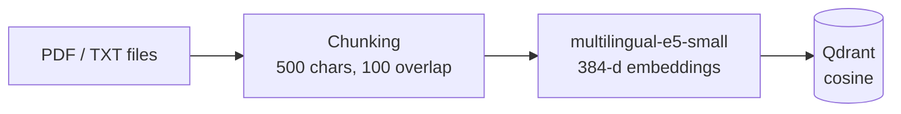

# Vietnamese Agentic RAG

Question answering over Vietnamese documents, with source citations in every answer.
The project is built up in three stages — **Naive RAG → Advanced RAG (Qdrant + cross-encoder
reranking) → Agentic RAG (LangGraph)** — and is served through a **FastAPI** REST API.

[](https://github.com/lmtndy/vietnamese-agentic-rag/actions/workflows/ci.yml)


## Architecture

**Offline — ingest documents** (`src/ingest.py`)



**Online — agentic answering** (`src/agent.py`)


| Step | What it does | Code |
|---|---|---|
| Ingest | Reads `.txt` / `.pdf`, splits into overlapping chunks, embeds with `intfloat/multilingual-e5-small`, stores vectors + source metadata in Qdrant | `src/ingest.py` |
| Retrieve | Bi-encoder search: top-20 candidate chunks from Qdrant | `src/rag.py` |
| Rerank | Cross-encoder `mmarco-mMiniLMv2-L12-H384-v1` (multilingual) re-scores each (question, chunk) pair, keeps top-4 | `src/rag.py` |
| Generate | Google Gemini answers **only** from the retrieved context and cites `[Nguồn X]` (“Source X”); says so when the answer is not in the documents | `src/rag.py` |
| Agent | LangGraph `StateGraph`: route → retrieve → grade → rewrite loop (max 2 retries) → generate | `src/agent.py` |
| API | `POST /ask`, `GET /health`, Swagger UI at `/docs`; models loaded once at startup (lifespan) | `src/api.py` |

## Design choices

- **Two-stage retrieval.** A bi-encoder embeds the question and chunks separately, so search is fast but coarse.
  A cross-encoder reads question and chunk together — more accurate but slower — so it only re-scores the 20 candidates.
- **Qdrant instead of FAISS.** The first version used an in-memory FAISS index; Qdrant runs as a real database
  service with persistence and payload metadata (source file, chunk id) used for citations.
- **Agent instead of a fixed pipeline.** A fixed pipeline always retrieves and always answers, even when retrieval misses.
  The agent skips retrieval for small talk, checks whether the context is relevant, and rewrites the query when it is not.
  Retries are bounded so the graph cannot loop forever.

## Evaluation

Retrieval quality is measured on **300 questions from [UIT-ViQuAD 2.0](https://huggingface.co/datasets/taidng/UIT-ViQuAD2.0)**
(human-written Vietnamese QA over Wikipedia). All 557 validation passages are indexed, so every question
has to find its passage among many same-topic distractors. A retrieved chunk counts as correct when it comes
from the right passage **and** contains the gold answer. The LLM reads the top-4 chunks, so **hit@4** is the
number that matters most.

| Chunk size (overlap 100) | Chunks | Bi-encoder hit@1 | Bi-encoder hit@4 | **+ Rerank hit@1** | **+ Rerank hit@4** | + Rerank MRR | Latency / query |
|---|---:|---:|---:|---:|---:|---:|---:|
| 200 | 4,646 | 0.477 | 0.727 | 0.580 | 0.787 | 0.675 | 221 ms |
| **500 (default)** | 1,363 | 0.597 | 0.813 | **0.773** | **0.883** | 0.828 | 551 ms |
| 800 | 866 | 0.660 | 0.867 | 0.807 | 0.927 | 0.865 | 797 ms |

*CPU only (8 cores). Latency = Qdrant retrieval (~18 ms) + cross-encoder reranking of 20 candidates.*

- **Reranking** lifts hit@1 from 0.60 to 0.77 and hit@4 from 0.81 to 0.88 at the default chunk size, for ~530 ms of extra CPU time per query.
- **Small chunks (200) hurt every metric**: they separate the answer sentence from the words the question shares with its context.
- **Larger chunks (800)** retrieve best here because ViQuAD passages are ~700 characters, so one chunk ≈ one passage — but they cost 45% more reranking time and 60% longer prompts. 500 stays the default until answer-level evaluation is in place.

Every run is logged to **MLflow** (parameters, metrics and per-question results), so configurations can be compared side by side:

```bash
python -m evaluation.build_golden                      # download UIT-ViQuAD 2.0, build the question set
python -m evaluation.run_retrieval_eval                # default config (chunk 500)
python -m evaluation.run_retrieval_eval --chunk-size 800
mlflow ui --backend-store-uri sqlite:///mlflow.db --host 127.0.0.1   # compare runs
```

The dataset is downloaded at run time and is not stored in this repository.

## Quickstart

```bash
git clone https://github.com/lmtndy/vietnamese-agentic-rag.git
cd vietnamese-agentic-rag
python -m venv .venv && source .venv/bin/activate
pip install -r requirements.txt

cp .env.example .env            # add your GOOGLE_API_KEY (free: https://aistudio.google.com/apikey)
docker run -d --name qdrant-rag -p 127.0.0.1:6333:6333 qdrant/qdrant

python -m src.ingest            # index the files in data/ (add your own .txt / .pdf there)
python -m src.chat              # CLI — Advanced RAG
python -m src.agent             # CLI — Agentic RAG (LangGraph)
uvicorn src.api:app --host 0.0.0.0 --port 8000   # REST API → http://localhost:8000/docs
```

Example request:

```bash
curl -X POST http://localhost:8000/ask \
     -H "Content-Type: application/json" \
     -d '{"question": "RAG là gì?", "top_k": 4}'
```

```json
{
  "answer": "RAG (Retrieval-Augmented Generation) là ... [Nguồn 1]",
  "sources": [{"source": "rag_gioi_thieu.txt", "score": 7.21, "preview": "GIỚI THIỆU VỀ RAG ..."}]
}
```

All settings (models, chunk size, top-N / top-K, retries) live in `src/config.py`.

## Project structure

```
├── data/              # source documents (sample: rag_gioi_thieu.txt)
├── src/
│   ├── config.py      # all settings
│   ├── chunking.py    # overlapping chunker (shared by ingest + evaluation)
│   ├── ingest.py      # offline: load → chunk → embed → Qdrant
│   ├── rag.py         # RAGEngine: retrieve → rerank → prompt → generate
│   ├── agent.py       # LangGraph agent (route / grade / rewrite)
│   ├── metrics.py     # hit@k, MRR
│   ├── chat.py        # CLI chat
│   └── api.py         # FastAPI service
├── evaluation/
│   ├── build_golden.py        # build the UIT-ViQuAD question set
│   └── run_retrieval_eval.py  # bi-encoder vs. rerank, logged to MLflow
├── tests/             # unit tests (pytest), run by GitHub Actions on every push
├── .github/workflows/ci.yml
└── NOTES.vi.md        # personal learning notes (Vietnamese)
```

## Limitations & next steps

- [x] **Retrieval evaluation:** hit@k / MRR on UIT-ViQuAD 2.0, bi-encoder vs. reranking, chunk-size comparison in MLflow
- [x] **CI:** unit tests on every push (GitHub Actions)
- [ ] **Answer evaluation:** LLM-as-judge for answer correctness and faithfulness to the retrieved context
- [ ] **Guardrails:** defenses against prompt injection through retrieved documents
- [ ] Expose the agent through the API and add `docker-compose` for app + Qdrant
- The bundled sample data is a single short document — add your own documents to `data/`.
