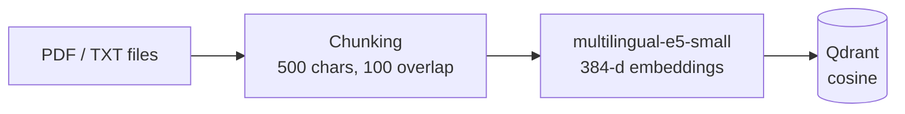
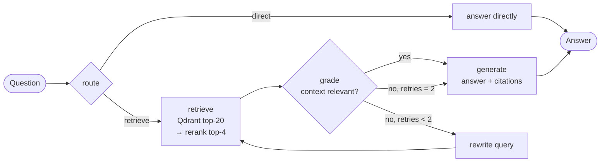

# Vietnamese Agentic RAG

Question answering over Vietnamese documents, with source citations in every answer.
The project is built up in three stages — **Naive RAG → Advanced RAG (Qdrant + cross-encoder
reranking) → Agentic RAG (LangGraph)** — and is served through a **FastAPI** REST API.


## Architecture

**Offline — ingest documents** (`src/ingest.py`)



**Online — agentic answering** (`src/agent.py`)



| Step | What it does | Code |
|---|---|---|
| Ingest | Reads `.txt` / `.pdf`, splits into overlapping chunks, embeds with `intfloat/multilingual-e5-small`, stores vectors + source metadata in Qdrant | `src/ingest.py` |
| Retrieve | Bi-encoder search: top-20 candidate chunks from Qdrant | `src/rag.py` |
| Rerank | Cross-encoder `mmarco-mMiniLMv2-L12-H384-v1` (multilingual) re-scores each (question, chunk) pair, keeps top-4 | `src/rag.py` |
| Generate | Google Gemini answers **only** from the retrieved context and cites `[Nguồn X]` (“Source X”); says so when the answer is not in the documents | `src/rag.py` |
| Agent | LangGraph `StateGraph`: route → retrieve → grade → rewrite loop (max 2 retries) → generate | `src/agent.py` |
| API | `POST /ask`, `GET /health`, Swagger UI at `/docs`; models loaded once at startup (lifespan) | `src/api.py` |

## Design choices

- **Two-stage retrieval.** A bi-encoder embeds the question and chunks separately, so search is fast but coarse.
  A cross-encoder reads question and chunk together — more accurate but slower — so it only re-scores the 20 candidates.
- **Qdrant instead of FAISS.** The first version used an in-memory FAISS index; Qdrant runs as a real database
  service with persistence and payload metadata (source file, chunk id) used for citations.
- **Agent instead of a fixed pipeline.** A fixed pipeline always retrieves and always answers, even when retrieval misses.
  The agent skips retrieval for small talk, checks whether the context is relevant, and rewrites the query when it is not.
  Retries are bounded so the graph cannot loop forever.

## Quickstart

```bash
git clone https://github.com/lmtndy/vietnamese-agentic-rag.git
cd vietnamese-agentic-rag
python -m venv .venv && source .venv/bin/activate
pip install -r requirements.txt

cp .env.example .env            # add your GOOGLE_API_KEY (free: https://aistudio.google.com/apikey)
docker run -d --name qdrant-rag -p 6333:6333 qdrant/qdrant

python -m src.ingest            # index the files in data/ (add your own .txt / .pdf there)
python -m src.chat              # CLI — Advanced RAG
python -m src.agent             # CLI — Agentic RAG (LangGraph)
uvicorn src.api:app --host 0.0.0.0 --port 8000   # REST API → http://localhost:8000/docs
```

Example request:

```bash
curl -X POST http://localhost:8000/ask \
     -H "Content-Type: application/json" \
     -d '{"question": "RAG là gì?", "top_k": 4}'
```

```json
{
  "answer": "RAG (Retrieval-Augmented Generation) là ... [Nguồn 1]",
  "sources": [{"source": "rag_gioi_thieu.txt", "score": 7.21, "preview": "GIỚI THIỆU VỀ RAG ..."}]
}
```

All settings (models, chunk size, top-N / top-K, retries) live in `src/config.py`.

## Project structure

```
├── data/              # source documents (sample: rag_gioi_thieu.txt)
├── src/
│   ├── config.py      # all settings
│   ├── ingest.py      # offline: load → chunk → embed → Qdrant
│   ├── rag.py         # RAGEngine: retrieve → rerank → prompt → generate
│   ├── agent.py       # LangGraph agent (route / grade / rewrite)
│   ├── chat.py        # CLI chat
│   └── api.py         # FastAPI service
└── NOTES.vi.md        # personal learning notes (Vietnamese)
```

## Limitations & next steps

- [ ] **Evaluation:** a labeled question set to measure hit@k / recall@k before vs. after reranking, plus LLM-as-judge for answer quality
- [ ] **Guardrails:** defenses against prompt injection through retrieved documents
- [ ] Expose the agent through the API and add `docker-compose` for app + Qdrant
- The bundled sample data is a single short document — add your own documents to `data/`.
